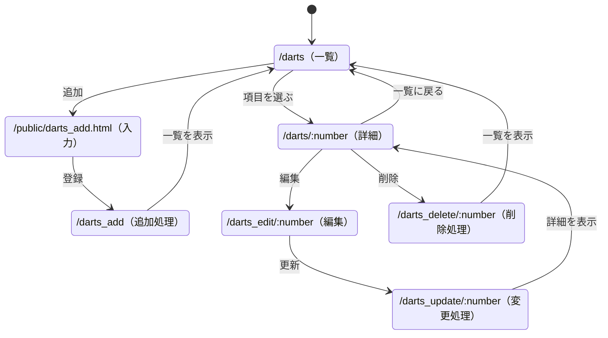

# レポート用に開発するシステムの設計（案）

学籍番号：26G1013　氏名：石川壮一朗

## 1. 概要

本ファイルには，レポート「基本的なデータ表示のWebアプリ開発」で開発する3つのシステムについて，対象，ページ遷移，スキーマを記す．
3つのシステムは，いずれも京葉線システムと同じく一覧表示をベースとし，データの一覧・詳細表示，追加，削除，変更を備える．
データは変数内に記録する．

| No. | システム名 | 対象とするデータ |
|---|---|---|
| A | ダーツ練習記録 | ダーツの練習で出したスコア |
| B | 3DCG作品ギャラリー | Blenderで制作した作品 |
| C | 英単語帳 | TOEIC対策で覚える英単語 |

各URLは現時点の仮のものである．
REST APIの説明を受けた後，URLとメソッドをREST APIの形式に合わせて変更する．

## 2. 共通のページ遷移

3つのシステムは，同じ形のページ遷移を持つ．
図1に，システムAを例としたページ遷移図を示す．
システムB，Cは，URLの `darts` をそれぞれ `works`，`words` に置き換えたものとなる．

図1　ページ遷移図（システムAの例）

データを追加した後は，一覧ページを表示する．
入力ページに戻す方法も試したが，登録できたかどうかが画面から分からなかったためである（第8回 やってみよう(1)）．
変更した後は，変更結果を確認できるように詳細ページを表示する．

## 3. システムA：ダーツ練習記録

### 3.1 対象

ダーツの練習で出したスコアを記録するシステムである．
利用者は，日付ごとの練習記録を一覧で見て，記録の追加，修正，削除を行う．
第8回 やってみよう(2)(3)で作成した `/darts` と `/darts_add` を拡張して開発する．

### 3.2 スキーマ

表1に，システムAのスキーマを示す．

表1　システムAのスキーマ

| 項目名 | 型 | 内容 |
|---|---|---|
| id | 数値 | 記録ID |
| date | 文字列 | 練習した日付（YYYY-MM-DD） |
| game | 文字列 | ゲームの種類（カウントアップなど） |
| score | 数値 | スコア |
| place | 文字列 | 練習した場所 |

一覧ページには日付，ゲーム，スコアを表示し，詳細ページには全項目を表示する．

## 4. システムB：3DCG作品ギャラリー

### 4.1 対象

Blenderで制作した3DCG作品とアニメーションを管理するシステムである．
利用者は，作品を一覧で見て，作品ごとの制作情報を詳細ページで確認する．

### 4.2 スキーマ

表2に，システムBのスキーマを示す．

表2　システムBのスキーマ

| 項目名 | 型 | 内容 |
|---|---|---|
| id | 数値 | 作品ID |
| title | 文字列 | 作品名 |
| type | 文字列 | 種類（静止画，アニメーションなど） |
| renderer | 文字列 | レンダラー（Eevee，Cyclesなど） |
| frames | 数値 | フレーム数（静止画は1） |
| created | 文字列 | 完成日（YYYY-MM-DD） |
| comment | 文字列 | 制作メモ |

一覧ページには作品名，種類，完成日を表示し，詳細ページには全項目を表示する．

## 5. システムC：英単語帳

### 5.1 対象

TOEIC対策で覚える英単語を記録するシステムである．
利用者は，単語を一覧で見て，詳細ページで意味と例文を確認する．
覚えたかどうかを変更機能で更新する．

### 5.2 スキーマ

表3に，システムCのスキーマを示す．

表3　システムCのスキーマ

| 項目名 | 型 | 内容 |
|---|---|---|
| id | 数値 | 単語ID |
| word | 文字列 | 英単語 |
| meaning | 文字列 | 日本語の意味 |
| part | 文字列 | 品詞 |
| example | 文字列 | 例文 |
| learned | 真偽値 | 覚えたかどうか |

一覧ページには英単語，意味，覚えたかどうかを表示し，詳細ページには全項目を表示する．

## 6. 今後の予定

- REST APIの説明を受けた後，図1のURLとメソッドをREST APIの形式に変更する．
- 各システムのJSファイルの先頭に `"use strict";` を付ける．
- 仕様書を，利用者向け，管理者向け，開発者向けの3部構成で作成する．
