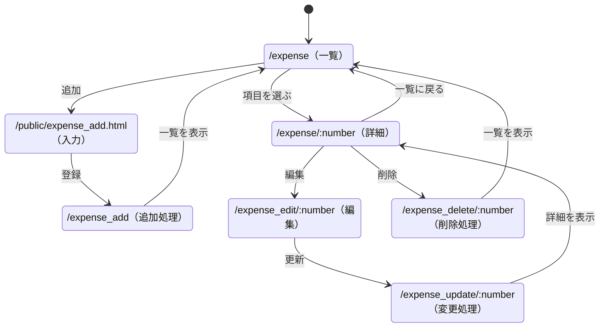

# レポート用に開発するシステムの設計（案）

学籍番号：26G1013　氏名：石川壮一朗

## 1. 概要

本ファイルには，レポート「基本的なデータ表示のWebアプリ開発」で開発する3つのシステムについて，対象，ページ遷移，スキーマを記す．
3つのシステムは，いずれも京葉線システムと同じく一覧表示をベースとし，データの一覧・詳細表示，追加，削除，変更を備える．
データは変数内に記録する．

| No. | システム名 | 対象とするデータ |
|---|---|---|
| A | 家計簿システム | 日々の支出 |
| B | トレーニング記録システム | 筋力トレーニングの記録 |
| C | 時間割システム | 履修している授業 |

各URLは現時点の仮のものである．
REST APIの説明を受けた後，URLとメソッドをREST APIの形式に合わせて変更する．

## 2. 共通のページ遷移

3つのシステムは，同じ形のページ遷移を持つ．
図1に，システムAを例としたページ遷移図を示す．
システムB，Cは，URLの `expense` をそれぞれ `training`，`timetable` に置き換えたものとなる．

図1　ページ遷移図（システムAの例）

データを追加した後は，一覧ページを表示する．
入力ページに戻す方法も試したが，登録できたかどうかが画面から分からなかったためである（第8回 やってみよう(1)）．
変更した後は，変更結果を確認できるように詳細ページを表示する．

## 3. システムA：家計簿システム

### 3.1 対象

日々の支出を記録するシステムである．
利用者は，支出を日付順の一覧で見て，支出の追加を行う．
金額や品目を入力し間違えた場合は変更機能で直し，記録が不要になった場合は削除機能で消す．

### 3.2 スキーマ

表1に，システムAのスキーマを示す．

表1　システムAのスキーマ

| 項目名 | 型 | 内容 |
|---|---|---|
| id | 数値 | 支出ID |
| date | 文字列 | 支出した日付（YYYY-MM-DD） |
| item | 文字列 | 品目 |
| category | 文字列 | カテゴリ（食費，交通費など） |
| price | 数値 | 金額 [円] |
| payment | 文字列 | 支払方法（現金，カードなど） |
| memo | 文字列 | メモ |

一覧ページには日付，品目，金額を表示し，詳細ページには全項目を表示する．

## 4. システムB：トレーニング記録システム

### 4.1 対象

筋力トレーニングの内容を記録するシステムである．
利用者は，トレーニングを日付順の一覧で見て，その日に行ったトレーニングを追加する．
重量や回数を入力し間違えた場合は変更機能で直す．

### 4.2 スキーマ

表2に，システムBのスキーマを示す．

表2　システムBのスキーマ

| 項目名 | 型 | 内容 |
|---|---|---|
| id | 数値 | 記録ID |
| date | 文字列 | トレーニングした日付（YYYY-MM-DD） |
| exercise | 文字列 | 種目（ベンチプレス，スクワットなど） |
| weight | 数値 | 重量 [kg] |
| reps | 数値 | 1セットあたりの回数 |
| sets | 数値 | セット数 |
| memo | 文字列 | メモ |

一覧ページには日付，種目，重量を表示し，詳細ページには全項目を表示する．

## 5. システムC：時間割システム

### 5.1 対象

履修している授業を管理するシステムである．
利用者は，授業を曜日と時限の順の一覧で見て，詳細ページで教室や担当教員を確認する．
教室が変わった場合は変更機能で直し，履修を取りやめた場合は削除機能で消す．

### 5.2 スキーマ

表3に，システムCのスキーマを示す．

表3　システムCのスキーマ

| 項目名 | 型 | 内容 |
|---|---|---|
| id | 数値 | 授業ID |
| name | 文字列 | 授業名 |
| day | 文字列 | 曜日 |
| period | 数値 | 時限 |
| room | 文字列 | 教室 |
| teacher | 文字列 | 担当教員 |
| credit | 数値 | 単位数 |

一覧ページには授業名，曜日，時限を表示し，詳細ページには全項目を表示する．

## 6. 今後の予定

- REST APIの説明を受けた後，図1のURLとメソッドをREST APIの形式に変更する．
- 各システムのJSファイルの先頭に `"use strict";` を付ける．
- 仕様書を，利用者向け，管理者向け，開発者向けの3部構成で作成する．
